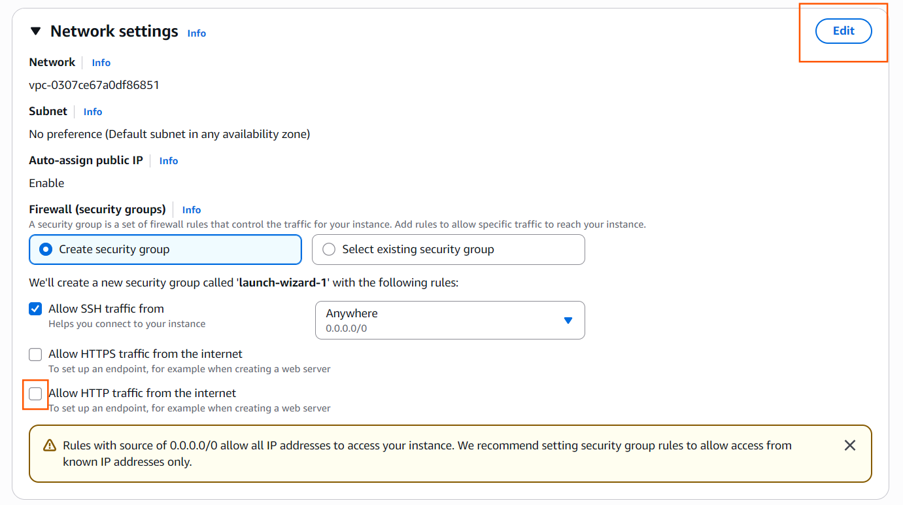
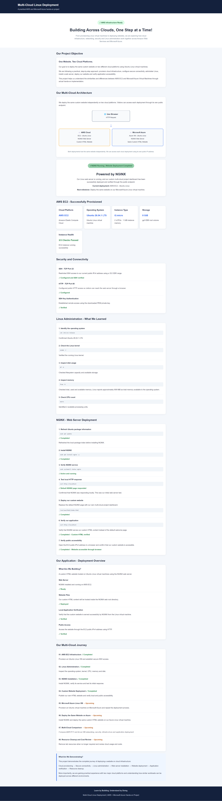
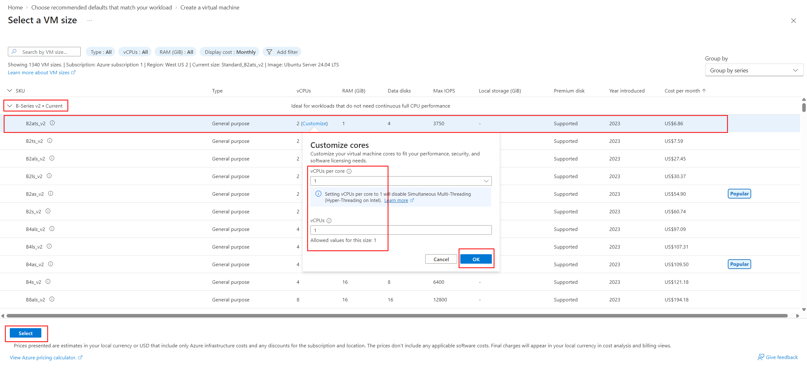
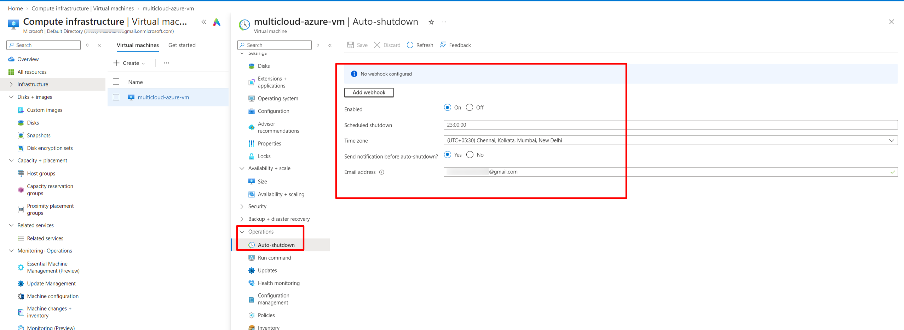
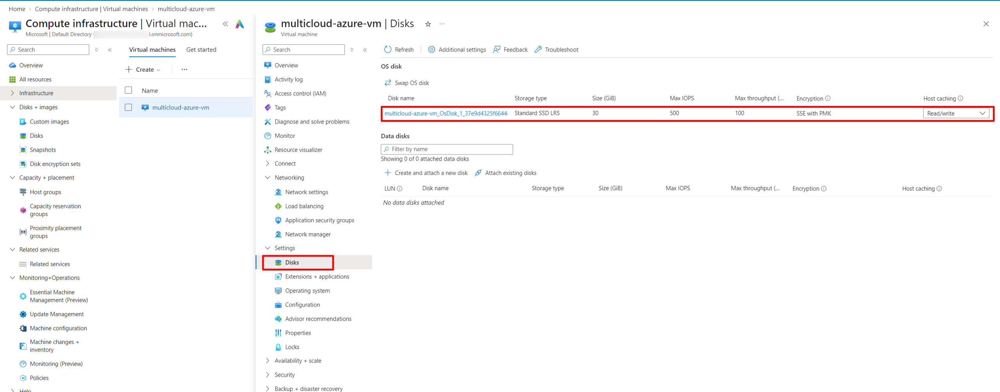
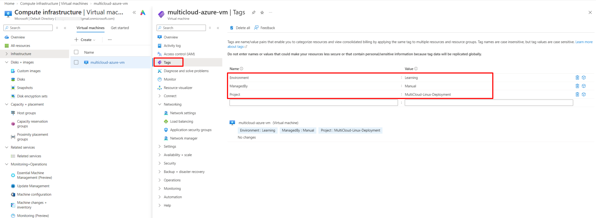
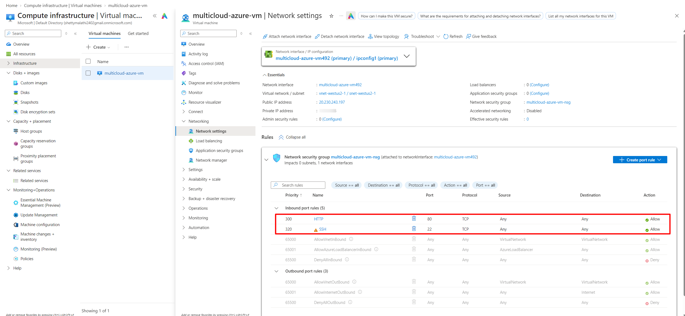

# Multi-Cloud Linux Deployment – AWS and Microsoft Azure

A hands-on cloud project demonstrating how to provision Ubuntu Linux virtual machines on **Amazon Web Services (AWS)** and **Microsoft Azure**, install NGINX, deploy the same custom HTML website, and verify public accessibility.

---

# 1. Problem Statement

In today's digital environment, businesses need reliable infrastructure to host websites and applications. Cloud platforms provide virtual machines, networking, storage, and security services that make it possible to deploy applications without maintaining physical servers.

However, beginners often find it difficult to understand how cloud infrastructure works in practice. They need hands-on experience with virtual machine provisioning, SSH connectivity, Linux administration, network security, and web server deployment.

This project addresses that learning gap by deploying the same custom HTML website independently on AWS and Microsoft Azure.

We provision Ubuntu Linux virtual machines, configure secure remote access, install NGINX, deploy the website, and verify that it is accessible through both cloud providers' public endpoints.

# 2. Why We Need This Use Case

This use case helps us understand the practical steps involved in hosting a website on cloud infrastructure.

Through this project, we learn how to:

- Provision and configure Linux virtual machines on AWS and Azure.
- Establish secure remote connectivity using SSH key authentication.
- Configure inbound network rules for SSH and HTTP traffic.
- Perform basic Linux system administration.
- Install and manage the NGINX web server.
- Deploy a custom HTML website.
- Verify local and public website connectivity.
- Compare infrastructure and networking configurations across two cloud platforms.

# 3. When We Need This Use Case

This type of deployment is useful when:

- Hosting a static website on a cloud virtual machine.
- Learning cloud infrastructure and Linux administration.
- Setting up a development or testing environment.
- Understanding how web applications are exposed through public endpoints.
- Comparing cloud services and deployment workflows across providers.
- Practising infrastructure deployment before moving to more advanced DevOps automation.

# 4. Prerequisites

Before starting the lab, ensure that we have:

| Requirement | Purpose |
|---|---|
| AWS account | To create an EC2 virtual machine |
| Microsoft Azure account | To create an Azure Linux VM |
| Windows computer | Local machine for managing the deployment |
| WSL Ubuntu or Git Bash | Terminal access and SSH commands |
| SSH client | To connect to remote Linux VMs |
| Git | To clone and manage the project repository |
| GitHub account | To store project files and screenshots |
| Basic Linux knowledge | To execute administration commands |
| Basic HTML knowledge | To understand the deployed website |

**Project repository:**

https://github.com/withmalathi/multi-cloud-linux-deployment

Clone the repository in the WSL Ubuntu terminal:

```bash
git clone https://github.com/withmalathi/multi-cloud-linux-deployment.git
```

Move into the project directory:

```bash
cd multi-cloud-linux-deployment
```

Verify the project files:

```bash
ls -la
```

Expected folders include:

```text
comparison-aws-azure/
screenshots/
website-pages-aws-azure/
README.md
```

### Local Terminal Setup for This Project

We use Windows as the local machine, with WSL Ubuntu and Git Bash for different tasks. Keep the terminal choice consistent with the commands shown in each phase.

| Activity | Terminal | Key path when stored under `D:\pem` |
|---|---|---|
| AWS SSH connection | WSL Ubuntu | `/mnt/d/pem/multicloud-aws-key.pem` |
| AWS website file transfer (`scp`) | WSL Ubuntu | `/mnt/d/pem/multicloud-aws-key.pem` |
| Azure SSH connection | Git Bash | `/d/pem/multicloud-azure-vm_key.pem` (copied into `~/.ssh/`) |
| Azure website file transfer (`scp`) | WSL Ubuntu | `/mnt/d/pem/multicloud-azure-vm_key.pem` |

WSL and Git Bash represent the Windows D: drive differently. Do not paste a WSL path into Git Bash or a Git Bash path into WSL without adapting it. Run `scp` from the local machine, not from inside the remote SSH session. Use `exit` to leave the remote session before running a local file-transfer command.

### Network Preparation

Both deployments need a public IP address, suitable internet routing, and inbound rules that allow HTTP traffic to reach NGINX. SSH is for administration and should be restricted to the current client public IP address using `/32`.

- **AWS:** Select a VPC and subnet with internet connectivity, ensure a public IPv4 address is assigned, allow SSH TCP 22 from **My IP**, and allow HTTP TCP 80 from `0.0.0.0/0` for public website access.
- **Azure:** Use the VM's Network Security Group (NSG), allow HTTP TCP 80 from Any, and restrict SSH TCP 22 to the current client public IP (`/32`).

Creating a VM alone does not make a website publicly accessible. Public IP addressing, routing and inbound security rules must work together.

### Screenshot and Recording Preparation

Before recording, verify that the screenshot folders and the image filenames referenced in this README match the files actually present in the repository. Run this command from the project root:

```bash
find screenshots comparison-aws-azure -type f
```

Compare the output with the Markdown image paths. Correct any mismatches before recording; do not assume a screenshot exists merely because its link appears in the README. Keep the AWS and Azure portals, the appropriate terminal windows and the four versioned HTML files ready. Never display private keys, passwords, tokens or other sensitive information while recording.

### Website Version Sequence

The website files intentionally show deployment progress in four stages:

1. AWS Version 1 – NGINX is running and website deployment is in progress.
2. AWS Version 2 – AWS deployment is completed; Azure is next.
3. Azure Version 1 – AWS is completed and Azure deployment is in progress.
4. Azure Version 2 – Both AWS and Azure deployments are completed.

This is a sequence of website updates, not a claim of cross-cloud failover, traffic management, synchronization or high availability. Each cloud hosts its own independent deployment.

**Important:** Create your own SSH key pairs during the lab. Never upload private SSH keys to GitHub or share them with anyone.

# 5. Advantages and Disadvantages

## Advantages

- **Cloud flexibility:** We can provision Linux virtual machines without maintaining physical servers.
- **Practical learning:** We gain hands-on experience with cloud infrastructure and Linux.
- **Portability:** The same static website can be deployed on different cloud providers.
- **Security awareness:** We learn to restrict SSH access and configure HTTP access.
- **Comparison:** We understand similarities and differences between AWS and Azure services.

## Disadvantages

- **Initial configuration:** Beginners need to understand virtual machines, networking, SSH and security rules.
- **Cost management:** Cloud resources may incur charges while running or after being stopped.
- **Security responsibility:** SSH access, firewall rules, credentials and software updates must be managed carefully.
- **Platform differences:** AWS and Azure use different terminology, portals and resource configuration workflows.

## 6. Step-by-Step Implementation

We will complete the project in four phases:

1. AWS EC2 deployment.
2. Microsoft Azure Linux VM deployment.
3. Multi-cloud comparison and verification.
4. Resource cleanup and cost review.

---

# Phase 1 – AWS EC2 Deployment

In this phase, we provision an Ubuntu Linux virtual machine on AWS, configure SSH and HTTP access, install NGINX, and deploy our custom multi-cloud dashboard.

Our AWS deployment has two website stages:

1. Version 1 – Website deployment in progress.

2. Version 2 – AWS website deployment completed.

## Step 1.1 – Launch an Ubuntu EC2 Instance

**What are we doing?**

We are creating a Linux virtual machine using Amazon EC2.

**Why are we doing this?**

The EC2 instance provides the compute environment on which we will install NGINX and host our website.

**How do we do it?**

1. Sign in to the AWS Management Console.

2. Open the **EC2** service.

3. Select **Launch instance**.

4. Enter the instance name: `multicloud-aws-vm`.

5. Under Application and OS Images, select Ubuntu Server 26.04.1 LTS (64-bit x86).

6. Select the instance type: `t3.micro`.

7. Create a new key pair:

   - Key pair name: `multicloud-aws-key`

   - Key pair type: RSA

   - Private key format: PEM

8. Download and securely store the private key.

9. Configure the network settings.

10. Configure the inbound security rules:

    - SSH – TCP port 22 – Source: My IP.

    - HTTP – TCP port 80 – Source: Anywhere IPv4 (`0.0.0.0/0`).

11. Configure the root storage:

    - Size: 8 GiB.

    - Volume type: gp3.

12. Review the configuration and select **Launch instance**.

**Screenshots**





**Expected result:**

The EC2 instance should reach the **Running** state, and its instance status checks should pass.

Our lab configuration:

| Setting | Value |

|---|---|

| Instance name | `multicloud-aws-vm` |

| Region | US West (Oregon) – `us-west-2` |

| Operating system | Ubuntu 26.04.1 LTS |

| Instance type | `t3.micro` |

| vCPU | 2 |

| Configured memory | 1 GiB |

| Root storage | 8 GiB gp3 |

| SSH key pair | `multicloud-aws-key` |

## Step 1.2 – Connect to the EC2 Instance Using SSH

**What are we doing?**

We are connecting from our local computer to the remote Ubuntu virtual machine.

**Why are we doing this?**

SSH provides secure command-line access so we can administer the Linux server remotely.

**How do we do it?**

Open the WSL Ubuntu terminal.

If the PEM key is stored on the Windows D: drive under `D:\pem`, its WSL path is `/mnt/d/pem`.

Set the private key permissions:

```bash

chmod 400 /mnt/d/pem/multicloud-aws-key.pem

```

Connect to the EC2 instance:

```bash

ssh -i /mnt/d/pem/multicloud-aws-key.pem ubuntu@<AWS_PUBLIC_IP>

```

Replace `<AWS_PUBLIC_IP>` with the public IPv4 address shown in the EC2 console.

**Screenshots**


**Expected result:**

We should successfully connect to the Ubuntu instance.

Verify the logged-in user:

```bash

whoami

```

Expected output:

```text

ubuntu

```


## Step 1.3 – Verify Linux System Information

Before installing the web server, we inspect the Linux environment.

Check the operating system:

```bash

cat /etc/os-release

```

Check the running kernel:

```bash

uname -r

```

Check the number of CPUs:

```bash

nproc

```

Check memory usage:

```bash

free -h

```

Check disk usage:

```bash

df -h

```

**Why are we doing this?**

These commands help us understand the operating system and compute resources available on our virtual machine.

**Expected result:**

We should see the Ubuntu operating system details, CPU count, memory information and available disk space.


## Step 1.4 – Update Ubuntu Package Information

**What are we doing?**

We are refreshing the package information available to Ubuntu.

**Why are we doing this?**

Before installing software, we should ensure that the package manager has the latest available package information.

Run:

```bash

sudo apt update

```

**Expected result:**

Ubuntu should retrieve package information from its configured repositories and complete the update successfully.


## Step 1.5 – Install NGINX

**What are we doing?**

We are installing NGINX on the Ubuntu virtual machine.

**Why are we doing this?**

NGINX will act as our web server and serve the custom HTML website over HTTP.

Run:

```bash

sudo apt install nginx -y

```

Check the NGINX service:

```bash

sudo systemctl status nginx --no-pager

```

Expected service status:

```text

Active: active (running)

```

Verify that NGINX is enabled:

```bash

sudo systemctl is-enabled nginx

```

Expected output:

```text

enabled

```


## Step 1.6 – Test NGINX Locally

Before deploying our custom website, we test the web server from inside the EC2 instance.

Run:

```bash

curl -I http://localhost

```

Expected response:

```text

HTTP/1.1 200 OK

Server: nginx

```

At this stage, NGINX should serve its default welcome page.


## Step 1.7 – Deploy Our Initial Custom Website – Version 1

**What are we doing?**

We are replacing the default NGINX welcome page with our custom multi-cloud project dashboard.

**Why are we doing this?**

The dashboard communicates the progress of our deployment and gives us a visible result to verify through the browser.

Our website files are maintained in:

```text

website-pages-aws-azure/

```

For the initial AWS deployment, we use:

```text

aws-website-version-1.html

```

For a fresh reproduction from this GitHub repository, open a second WSL terminal and navigate to the project:

```bash

cd ~/multi-cloud-linux-deployment

```

Copy Version 1 to the EC2 instance:

```bash

scp -i /mnt/d/pem/multicloud-aws-key.pem \\

website-pages-aws-azure/aws-website-version-1.html \\

ubuntu@<AWS_PUBLIC_IP>:/tmp/index.html

```

Connect to the EC2 instance if necessary:

```bash

ssh -i /mnt/d/pem/multicloud-aws-key.pem ubuntu@<AWS_PUBLIC_IP>

```

Install the HTML file in the NGINX web root:

```bash

sudo install -o www-data -g www-data -m 644 /tmp/index.html /var/www/html/index.html

```

Verify the file:

```bash

sudo ls -lh /var/www/html/index.html

```

**Expected result:**

The custom `index.html` file should exist inside `/var/www/html/`.

Our initial AWS dashboard shows that NGINX is running and website deployment is in progress.


## Step 1.8 – Verify the Initial AWS Website

First, verify the website locally:

```bash

curl -I http://localhost

```

Expected response:

```text

HTTP/1.1 200 OK

```

Inspect the served HTML:

```bash

curl -s http://localhost | head -20

```

Next, open a browser and enter:

```text

http://<AWS_PUBLIC_IP>/

```

Replace the placeholder with the EC2 public IPv4 address.

**Expected result:**

Our custom Version 1 dashboard should load in the browser.


## Step 1.9 – Update the AWS Website to Version 2

After verifying the initial website, we update the dashboard to reflect the completed AWS deployment.

The updated file is:

```text

aws-website-version-2.html

```

From the local WSL terminal, navigate to the repository:

```bash

cd ~/multi-cloud-linux-deployment

```

Copy Version 2 to the EC2 instance:

```bash

scp -i /mnt/d/pem/multicloud-aws-key.pem \\

website-pages-aws-azure/aws-website-version-2.html \\

ubuntu@<AWS_PUBLIC_IP>:/tmp/index.html

```

Connect to the EC2 instance if necessary:

```bash

ssh -i /mnt/d/pem/multicloud-aws-key.pem ubuntu@<AWS_PUBLIC_IP>

```

Replace the existing website:

```bash

sudo install -o www-data -g www-data -m 644 /tmp/index.html /var/www/html/index.html

```

Verify the updated page:

```bash

curl -s http://localhost | head -20

```

Open the public endpoint again:

```text

http://<AWS_PUBLIC_IP>/

```

**Expected result:**

The AWS dashboard now shows:

**NGINX Running | Website Deployment Completed**

It also identifies Azure as the next deployment milestone.




**AWS deployment milestone completed:** Ubuntu EC2 provisioned, SSH connectivity verified, NGINX installed, and the custom website deployed, updated and publicly accessible.

---

# Phase 2 – Microsoft Azure Linux VM Deployment

In this phase, we create a second Ubuntu Linux virtual machine on Microsoft Azure and deploy the same multi-cloud dashboard.

Our Azure website also has two stages:

1. Version 1 – AWS deployment completed; Azure deployment in progress.

2. Version 2 – AWS and Azure deployments completed.

## Step 2.1 – Create an Azure Resource Group

**What are we doing?**

We are creating a resource group to organize the Azure resources used in this project.

**Why are we doing this?**

A resource group provides a logical container for related resources, making them easier to manage and clean up.

**How do we do it?**

1. Sign in to the Azure Portal.

2. Search for **Resource groups**.

3. Select **Create**.

4. Choose the subscription.

5. Enter the resource group name: `multicloud-linux-rg`.

6. Select the region: `West US 2`.

7. Add the following tags:

| Tag | Value |

|---|---|

| Project | `MultiCloud-Linux-Deployment` |

| Environment | `Learning` |

| ManagedBy | `Manual` |

8. Select **Review + create**, then **Create**.

**Expected result:**

The resource group should be created successfully.


## Step 2.2 – Create an Ubuntu Linux Virtual Machine

**What are we doing?**

We are provisioning an Ubuntu virtual machine in Microsoft Azure.

**Why are we doing this?**

We need a second Linux environment to deploy the same website and compare the cloud platforms.

**How do we do it?**

1. Search for **Virtual machines** in the Azure Portal.

2. Select **Create** → **Azure virtual machine**.

3. Under Project details:

   - Subscription: Select your Azure subscription.

   - Resource group: `multicloud-linux-rg`.

4. Under Instance details:

   - Virtual machine name: `multicloud-azure-vm`.

   - Region: `West US 2`.

   - Security type: Standard.

   - Image: Ubuntu Server 24.04 LTS.

   - Size: `Standard_B2ats_v2`.

5. Under Administrator account:

   - Authentication type: SSH public key.

   - Username: `azureuser`.

   - Generate a new SSH key pair.

   - Key pair name: `multicloud-azure-vm_key`.

6. Download and securely store the private key.

7. Configure the inbound ports and networking.

8. Under Disks, select Standard SSD locally redundant storage (LRS) for the OS disk.

9. Under Management, configure auto-shutdown if desired.

10. Review the configuration and select **Create**.

Our lab auto-shutdown setting was configured for 19:00 IST.

**Expected result:**

Azure should deploy the virtual machine successfully.

Our lab configuration:

| Setting | Value |

|---|---|

| Resource group | `multicloud-linux-rg` |

| VM name | `multicloud-azure-vm` |

| Region | West US 2 |

| Operating system | Ubuntu 24.04.5 LTS |

| VM size | `Standard_B2ats_v2` |

| vCPU | 1 |

| Reported memory | Approximately 887 MiB |

| OS disk | Standard SSD LRS |

| Username | `azureuser` |

| SSH authentication | SSH key pair |

**Screenshots**












## Step 2.3 – Configure Azure Network Security Group Rules

**What are we doing?**

We are configuring inbound network rules to control traffic reaching the Azure virtual machine.

**Why are we doing this?**

SSH is required for administration, while HTTP is required for public website access.

Open the VM's **Networking** section and navigate to its Network Security Group inbound security rules.

Configure or verify these rules:

| Rule | Priority | Protocol | Port | Source | Action |

|---|---:|---|---:|---|---|

| HTTP | 300 | TCP | 80 | Any | Allow |

| SSH | 320 | TCP | 22 | Your public IP (`/32`) | Allow |

**Important security learning:**

During our configuration review, we identified that SSH was initially open to the entire internet. We corrected the rule to restrict SSH access to our current public IP address.

For a new deployment, configure SSH with a restricted source address from the beginning.




**Expected result:**

The NSG should allow public HTTP traffic on port 80 and SSH traffic on port 22 only from the configured client IP.

## Step 2.4 – Connect to the Azure VM Using SSH

**What are we doing?**

We are connecting to the Azure Ubuntu VM from our local computer.

**How do we do it?**

Open Git Bash on Windows.

If the downloaded private key is stored in `D:\pem`, copy it into the Git Bash SSH directory:

```bash

mkdir -p ~/.ssh

cp /d/pem/multicloud-azure-vm_key.pem ~/.ssh/

chmod 400 ~/.ssh/multicloud-azure-vm_key.pem

```

Connect to the VM:

```bash

ssh -i ~/.ssh/multicloud-azure-vm_key.pem azureuser@<AZURE_PUBLIC_IP>

```

Replace `<AZURE_PUBLIC_IP>` with the public IP shown in the Azure Portal.

**Expected result:**

We should successfully connect to the Azure Ubuntu VM.

Verify the logged-in user:

```bash

whoami

```

Expected output:

```text

azureuser

```

Check the hostname:

```bash

hostname

```

Expected output:

```text

multicloud-azure-vm

```


## Step 2.5 – Verify Azure Linux System Information

Run the following commands:

```bash

cat /etc/os-release

```

```bash

uname -r

```

```bash

nproc

```

```bash

free -h

```

```bash

df -h

```

**Why are we doing this?**

We are inspecting the operating system, kernel, CPU, memory and disk resources before installing the web server.

**Expected result:**

The VM should report Ubuntu 24.04.5 LTS, one CPU, approximately 887 MiB of memory, and its available disk space.


## Step 2.6 – Update Ubuntu Package Information

Run:

```bash

sudo apt update

```

**Expected result:**

Ubuntu should retrieve package information successfully.


## Step 2.7 – Install NGINX on Azure

Run:

```bash

sudo apt install nginx -y

```

Check the service:

```bash

sudo systemctl status nginx --no-pager

```

Expected status:

```text

Active: active (running)

```

Verify that the service is enabled:

```bash

sudo systemctl is-enabled nginx

```

Expected output:

```text

enabled

```


## Step 2.8 – Test NGINX Locally and Through the Public Endpoint

Run:

```bash

curl -I http://localhost

```

**Expected result:**

The local HTTP request should return:

```text

HTTP/1.1 200 OK

```

At this stage, the default NGINX welcome page should be available.


Open the following address in a web browser, replacing the placeholder with the Azure VM public IP address:

```text
http://<AZURE_PUBLIC_IP>/
```

Alternatively, run this command from the local terminal to test the public endpoint:

```bash
curl -I http://<AZURE_PUBLIC_IP>/
```

**Expected result:**

The public HTTP request should return:


## Step 2.9 – Identify the NGINX Web Root and Back Up the Default Page

Before replacing the default page, we inspect the existing files and identify the web root.

Check the NGINX configuration:

```bash

sudo nginx -T 2>/dev/null | grep -E 'root |index '

```

Expected configuration includes:

```text

root /var/www/html;

index index.html index.htm index.nginx-debian.html;

```

Inspect the web root:

```bash

ls -la /var/www/html/

```

On our Azure VM, the default welcome page was:

```text

index.nginx-debian.html

```

Back up the existing page:

```bash

sudo cp /var/www/html/index.nginx-debian.html \\

/var/www/html/index.nginx-debian.html.backup

```

Verify the backup:

```bash

ls -lh /var/www/html/

```

**Why are we doing this?**

We should identify the actual file served by NGINX before modifying it. A backup gives us a recovery copy of the original welcome page.

**Screenshots**


## Step 2.10 – Deploy the Initial Azure Website – Version 1

**What are we doing?**

We are deploying the initial Azure version of our multi-cloud dashboard.

**Why are we doing this?**

At this stage, AWS deployment is completed, while Azure public verification is still in progress.

The initial Azure file is:

```text

azure-website-version-1.html

```

For a fresh reproduction from the repository, open a local WSL terminal:

```bash

cd ~/multi-cloud-linux-deployment

```

Copy Version 1 to the Azure VM:

```bash

scp -i /mnt/d/pem/multicloud-azure-vm_key.pem \\

website-pages-aws-azure/azure-website-version-1.html \\

azureuser@<AZURE_PUBLIC_IP>:/tmp/index.html

```

Connect to the Azure VM if necessary:

```bash

ssh -i /mnt/d/pem/multicloud-azure-vm_key.pem azureuser@<AZURE_PUBLIC_IP>

```

Install the HTML file in the NGINX web root:

```bash

sudo install -o www-data -g www-data -m 644 /tmp/index.html /var/www/html/index.html

```

Verify the file:

```bash

sudo ls -lh /var/www/html/index.html

```

**Expected result:**

The custom Version 1 website should be available inside the NGINX web root.


## Step 2.11 – Verify the Initial Azure Website

First, verify locally:

```bash

curl -I http://localhost

```

Inspect the website content:

```bash

curl -s http://localhost | head -20

```

Next, open a browser and enter:

```text

http://<AZURE_PUBLIC_IP>/

```

**Expected result:**

The initial Azure dashboard should load. It should show that AWS deployment is completed and Azure public verification is still pending.


**Recording screenshot cue:** Capture the initial Azure Version 1 public website in the browser during the recording and add its verified filename here if that screenshot is not already present in the repository.

## Step 2.12 – Update the Azure Website to Version 2

After verifying the initial Azure website through its public endpoint, we update the dashboard to reflect the completion of both deployments.

The updated file is:

```text

azure-website-version-2.html

```

From the local WSL terminal:

```bash

cd ~/multi-cloud-linux-deployment

```

Copy Version 2 to the Azure VM:

```bash

scp -i /mnt/d/pem/multicloud-azure-vm_key.pem \\

website-pages-aws-azure/azure-website-version-2.html \\

azureuser@<AZURE_PUBLIC_IP>:/tmp/index.html

```

Connect to the Azure VM if necessary:

```bash

ssh -i /mnt/d/pem/multicloud-azure-vm_key.pem azureuser@<AZURE_PUBLIC_IP>

```

Replace the existing website:

```bash

sudo install -o www-data -g www-data -m 644 /tmp/index.html /var/www/html/index.html

```

Verify the updated page locally:

```bash

curl -s http://localhost | head -20

```

Open the public endpoint again:

```text

http://<AZURE_PUBLIC_IP>/

```

**Expected result:**

The final dashboard should show:

**AWS and Azure Deployments Completed**

It should also show that the same custom website has been deployed and verified through both public endpoints.


**Azure deployment milestone completed:** Ubuntu VM provisioned, SSH connectivity verified, NGINX installed, and the custom dashboard deployed, updated and publicly accessible.

---

# Phase 3 – Multi-Cloud Comparison and Verification

After completing both deployments, we compare the infrastructure, network security and public website results.

## Step 3.1 – Compare the Virtual Machine Configurations

| Configuration | AWS | Microsoft Azure |

|---|---|---|

| Cloud service | Amazon EC2 | Azure Virtual Machine |

| Region | US West (Oregon) | West US 2 |

| VM name | `multicloud-aws-vm` | `multicloud-azure-vm` |

| Operating system | Ubuntu 26.04.1 LTS | Ubuntu 24.04.5 LTS |

| VM size | `t3.micro` | `Standard_B2ats_v2` |

| vCPU | 2 | 1 |

| Memory | 1 GiB configured | Approximately 887 MiB reported |

| Storage | 8 GiB gp3 EBS | Standard SSD |

| Web server | NGINX | NGINX |


## Step 3.2 – Compare Network Security

| Configuration | AWS | Microsoft Azure |

|---|---|---|

| Network security service | Security Group | Network Security Group |

| SSH | TCP 22, restricted to client IP `/32` | TCP 22, restricted to client IP `/32` |

| HTTP | TCP 80, public | TCP 80, public |

| Remote access | SSH key authentication | SSH key authentication |


## Step 3.3 – Compare Website Deployment

The same custom HTML dashboard was deployed on both Ubuntu virtual machines using NGINX.


**AWS website:**


**Azure website:**


## Step 3.4 – Understand the Similarities and Differences

### Similarities

- Both platforms provide cloud-based Linux virtual machines.

- Both support SSH key-based authentication.

- Both provide network security services to control inbound traffic.

- Both support NGINX as a web server.

- Both successfully hosted our custom HTML website.

### Differences

- AWS uses EC2, while Azure provides Virtual Machines.

- AWS uses Security Groups, while Azure uses Network Security Groups.

- VM sizes and resource specifications differ.

- Storage services and configuration options differ.

- Cloud portal layouts and resource management workflows differ.

## Step 3.5 – Common Verification Commands

| Command | Purpose |

|---|---|

| `whoami` | Verify the logged-in user |

| `hostname` | Check the VM hostname |

| `cat /etc/os-release` | Identify the operating system |

| `uname -r` | Check the running kernel |

| `nproc` | Check available CPU cores |

| `free -h` | Inspect memory usage |

| `df -h` | Inspect disk usage |

| `sudo systemctl status nginx --no-pager` | Check NGINX service status |

| `curl -I http://localhost` | Verify the local HTTP response |

| `curl -s http://localhost` | Inspect the served website content |

**Final verification checklist:**

- [x] AWS EC2 instance provisioned.

- [x] AWS SSH connectivity verified.

- [x] AWS Linux system information inspected.

- [x] AWS NGINX installed and running.

- [x] AWS Version 1 website deployed and verified.

- [x] AWS Version 2 website update verified.

- [x] Azure Linux VM provisioned.

- [x] Azure SSH connectivity verified.

- [x] Azure SSH access restricted to the client IP.

- [x] Azure Linux system information inspected.

- [x] Azure NGINX installed and running.

- [x] Azure Version 1 website deployed and verified.

- [x] Azure Version 2 website update verified.

- [x] Both websites verified through their public endpoints.

- [x] AWS and Azure infrastructure compared.

---

**Building practical cloud skills through hands-on deployment, verification and comparison across AWS and Microsoft Azure.**

---

---

# Phase 4 – Cleanup and Cost Review

After completing the deployment and comparison, we clean up the cloud resources created for this learning project. This helps avoid unnecessary ongoing charges.

Cloud resources may continue to incur charges even when we are no longer using the virtual machines. Stopping a VM does not necessarily remove charges for associated disks, public IP addresses or other retained resources. Before cleanup, make sure that all required screenshots, website files and project documentation are saved in GitHub.

> **Recording and evidence note:** The cleanup walkthrough and cost-review steps are documented for the recording. The actual AWS and Azure resource deletion has not been represented as completed here. Perform the deletion, verify the results in both portals, and add the corresponding screenshots before marking cleanup itself complete.

## Step 4.1 – Clean Up AWS Resources

1. Sign in to the AWS Management Console.
2. Open **EC2** and select **Instances**.
3. Select `multicloud-aws-vm`.
4. Choose **Instance state** → **Terminate instance**.
5. Confirm termination.
6. Open **Security Groups** and review the security group created for this lab.
7. Delete the lab security group if it is no longer in use and AWS allows it to be deleted.
8. Open **Volumes** and review the EBS volume associated with the terminated instance. Confirm whether it was deleted automatically; delete any remaining lab volume only after confirming it is not needed.
9. Open **Elastic IPs** and check whether any address was allocated for this lab. Release it if it is no longer required.

**Important:** Do not delete shared/default VPC networking resources or security groups that are used by other workloads. Only remove resources created specifically for this project and confirmed to be unused.

**Expected result:**

The lab EC2 instance should be terminated, and any project-specific billable resources that are no longer required should be removed.

**Cleanup evidence to add during recording:**

- Screenshot showing the EC2 instance in the terminated state.
- Screenshot showing the review of the project security group.
- Screenshot showing the review of EBS volumes and Elastic IPs, where applicable.

## Step 4.2 – Clean Up Microsoft Azure Resources

The Azure resources for this project were grouped under:

`multicloud-linux-rg`

To remove the project resources together:

1. Sign in to the Azure Portal.
2. Open **Resource groups**.
3. Select `multicloud-linux-rg`.
4. Review the resources listed in the resource group.
5. Confirm that the group contains only resources created for this project and that nothing needs to be retained.
6. Select **Delete resource group**.
7. Enter the resource group name when prompted.
8. Confirm deletion.

Deleting the resource group removes the resources contained in it, including the VM and its associated resources, subject to Azure's deletion process.

**Expected result:**

The resource group `multicloud-linux-rg` should no longer appear in the active resource group list after deletion completes.

**Cleanup evidence to add during recording:**

- Screenshot showing the resources inside `multicloud-linux-rg` before deletion.
- Screenshot showing the deletion confirmation or deletion completion.
- Screenshot showing that the resource group is no longer listed.

## Step 4.3 – Review Cloud Costs

After cleanup:

- Review the AWS billing and cost pages for any remaining resources or charges.
- Review Azure Cost Management for any remaining resources or charges.
- Remember that stopping a VM does not necessarily remove charges for attached disks, public IP addresses, or other retained resources.
- Billing data may take time to reflect resource deletion.

**Expected result:**

We should confirm that the resources created for this lab have been removed and review both cloud platforms for any remaining project-related resources or charges.

## Cleanup Milestone

- [x] AWS EC2 cleanup instructions documented.
- [x] AWS security group, EBS volume and Elastic IP review documented.
- [x] Azure resource group cleanup instructions documented.
- [x] AWS and Azure cost-review steps documented.
- [ ] Actual AWS resource deletion performed and verified.
- [ ] Actual Azure resource group deletion performed and verified.
- [ ] Cleanup evidence screenshots captured and added.

---

# 7. Project Milestones

| # | Milestone | Status |
|---|---|---|
| 01 | AWS EC2 infrastructure provisioning | Completed |
| 02 | AWS Linux administration | Completed |
| 03 | AWS NGINX installation | Completed |
| 04 | AWS custom website deployment | Completed |
| 05 | Azure Linux VM provisioning | Completed |
| 06 | Azure Linux administration and NGINX installation | Completed |
| 07 | Azure custom website deployment | Completed |
| 08 | Azure public website verification | Completed |
| 09 | Multi-cloud comparison | Completed |
| 10 | Resource cleanup and cost review | Pending – perform and verify during recording |

Update the final milestone after completing and verifying resource cleanup.

# 8. Repository Structure

The repository is organized so that the README remains the main project guide, screenshots provide implementation evidence, and the versioned HTML files preserve the website progression.

```text
multi-cloud-linux-deployment/
├── README.md
├── comparison-aws-azure/
│   ├── aws-azure-network-security.png
│   ├── aws-azure-public-website-deployment.png
│   └── aws-azure-vm-configuration.png
├── screenshots/
│   ├── aws-screenshots/
│   └── az-screenshots/
└── website-pages-aws-azure/
    ├── aws-website-version-1.html
    ├── aws-website-version-2.html
    ├── azure-website-version-1.html
    └── azure-website-version-2.html
```

All implementation instructions and explanations are maintained in this `README.md`. No separate documentation folder is required for this project.

---

# 9. Screenshots and Documentation

The repository includes screenshots and comparison images captured during the deployment. The screenshots used throughout this README are organized by cloud platform:

- `screenshots/aws-screenshots/` – AWS EC2 creation, SSH access, Linux checks, NGINX installation, website deployment and verification.
- `screenshots/az-screenshots/` – Azure resource group and VM creation, network security, SSH access, Linux checks, NGINX installation, website deployment and verification.
- `comparison-aws-azure/` – side-by-side comparisons of VM configuration, network security and website deployment.
- `website-pages-aws-azure/` – the four HTML files used to show deployment progress across AWS and Azure.

The versioned website files are stored in `website-pages-aws-azure/`:

| File | Purpose |
|---|---|
| `aws-website-version-1.html` | Initial AWS dashboard showing website deployment in progress |
| `aws-website-version-2.html` | Updated AWS dashboard showing AWS deployment completed |
| `azure-website-version-1.html` | Initial Azure dashboard showing AWS completed and Azure in progress |
| `azure-website-version-2.html` | Final dashboard showing both AWS and Azure deployments completed |

This version progression records how the dashboard was updated as each cloud deployment was completed.

---

# 10. Key Learnings

Through this hands-on project, we practised:

- Provisioning Ubuntu Linux virtual machines on AWS and Microsoft Azure.
- Understanding the basic VM configuration options available on each cloud platform.
- Creating and securely using SSH key pairs for remote Linux administration.
- Configuring inbound network access for SSH and HTTP.
- Restricting SSH access to a known client IP address.
- Inspecting Linux operating system, kernel, CPU, memory and disk information.
- Updating Ubuntu package information using `apt`.
- Installing and managing the NGINX service using `systemctl`.
- Understanding the NGINX web root at `/var/www/html`.
- Backing up the existing default website before replacing it.
- Deploying and updating a custom HTML website.
- Verifying the website locally with `curl` and externally through a browser.
- Comparing AWS Security Groups with Azure Network Security Groups.
- Comparing VM sizes, compute resources, storage and cloud management workflows.
- Reviewing resource cleanup and cloud cost considerations.

Most importantly, we learned that the same Linux administration and web-server concepts can be applied across different cloud platforms, even though the provisioning portals and networking services differ.

---

# 11. Conclusion

In this project, we successfully deployed the same custom HTML dashboard on two Ubuntu Linux virtual machines: one hosted on Amazon EC2 and the other on Microsoft Azure.

We configured SSH access, reviewed Linux system resources, installed NGINX, deployed the website, verified local HTTP responses and tested both public endpoints. We also compared the VM configurations and network security controls available on AWS and Azure.

The project demonstrates a practical multi-cloud deployment workflow using Linux, cloud virtual machines, SSH, network security rules and NGINX.

It also reinforces the importance of verifying each stage, keeping deployment evidence, and reviewing cloud resources for cleanup and cost management after completing a lab.

---

# Author

**Malathi Shetty**

- GitHub: [withmalathi](https://github.com/withmalathi)
- Project repository: [Multi-Cloud Linux Deployment – AWS and Microsoft Azure](https://github.com/withmalathi/multi-cloud-linux-deployment)

---

*Building practical cloud skills through hands-on deployment, verification and comparison across AWS and Microsoft Azure.*
